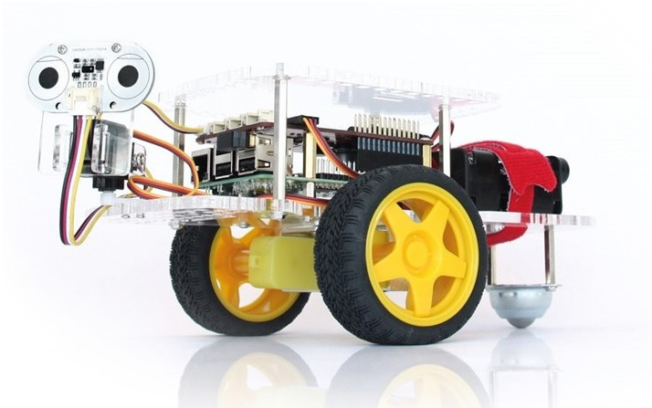

# Remote_Camera_Robot
Remote Camera Robot Implementation on Trixie

This project will consist of two major branches:
1. The "original" Remote Camera Robot as implemented by Dexter Industries for Buster, ported to Trixie.
2. My "New Remote Camera Robot" project using a joystick to control a robot and its pan-and-tilt.

Initial goal: Implement the original, known working, Remote Camera Robot on Trixie.

Subsequent goal: Using the working Remote Camera Robot port to port New Remote Camera Robot to Trixie.

---

## Project Summary

In this project we can remotely control a GoPiGo3 robot via a mobile device or a laptop.


## Requirements

We need the following components for this project:

* A [GoPiGo3](https://www.dexterindustries.com/gopigo3/) robot - it also includes the battery pack.
* A [Raspberry Pi](https://www.dexterindustries.com/raspberry-pi/).
* A [Pi Camera](https://www.dexterindustries.com/shop/raspberry-pi-camera/).
* A laptop or a mobile device (aka smartphone).
* A copy of the current [GoPiGo O/S](https://gopigo.io/gopigo-os-latest/)
### Note: Remote Camera Robot does not yet work on any Raspberry Pi O/S later than Buster.

## Setting Up

The easiest way to use the Remote Camera Robot is to download and install the latest GoPiGo O/S.

### Note that Remote Camera Robot will not work on any O/S later than Buster.

If you are using a different O/S - based on a Debian Buster release - do the following:

In order to proceed the setup, make sure you have the `GoPiGo3` repository installed (not just cloned, but also installed) or that you have the latest version of `GoPiGo O/S`.  Note that GoPiGo O/S already has the Remote Camera Robot installed along with all the needed dependencies.

To install the GoPiGo robot libraries and code in a different O/S, first clone the Dexter Industries GoPiGo repository via:
`git clone https://github.com/DexterInd/GoPiGo3.git`

After going through the above paragraph, install the `Pi Camera` dependencies and `Flask` by running following command:
```
sudo pip3 install -r requirements.txt
```
Verify that you have Thonny installed. You can run the program from the command line, but Thonny is easier.  Run\
`sudo apt-get install thonny`

You should now have everything set up.

## Running it

Start the server by navigating to the Remote Camera Robot directory at:\
`/home/pi/Dexter/GoPiGo3/Projects/RemoteCameraRobot`,\
then type the following command:
```
python3 remote_robot.py
```
or run it within Thonny by right-clicking on the program file and selecting "Thonny".

It's going to take a couple of seconds for the server to fire up.

The web app is set to port `5000` whereas the video stream is found at port `5001`.

If you have got `GoPiGo O/S` installed, then going to `http://GoPiGo3:5000` address will be enough.
If you don't have `GoPiGo O/S`, then you'll need to see what's your interface's IP address.

Also, please make sure you have your mobile device / laptop on the same network as your `GoPiGo3`. Otherwise, you won't be able to access it.

## Setting Up to Run on Boot
You can run the server on boot so you don't have to run it manually.  Use the command
`install_startup.sh`
and this should start the flask server on boot.  You should be able to connect to the robot using "http://10.10.10.10:5000"

You can install GoPiGo O/S which will automatically setup a wifi access point, with the command
On reboot, connect to the WiFi service "GoPiGo3"

## YouTube Video

#### When loading `http://gopigo:5000` for the first time, click a couple of times on the screen without moving the mouse around, in order to enable the "joystick" functionality.

Here's a YouTube video of this project:

[](https://youtu.be/jyg_nt28ktk)
